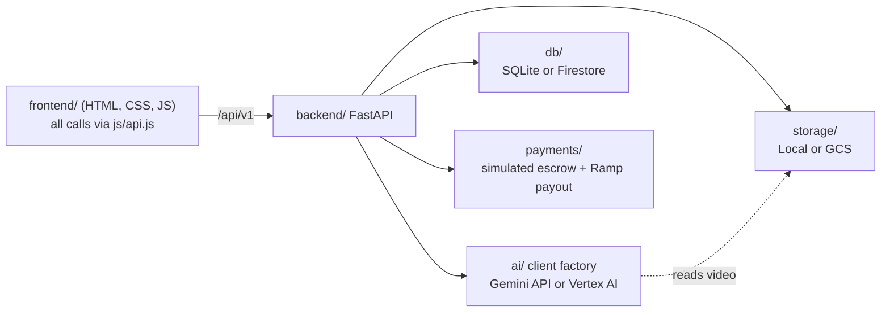

# BMT · Architecture

## Principle

Build once, run in two modes. Tonight everything runs **locally** with a free Gemini API
key. On Day 1 we flip environment variables to run on **Google Cloud**. Every Google
service sits behind a small interface, so switching is configuration, not a rewrite.

| Concern | Local mode (tonight) | Cloud mode (Day 1) | Switch |
|---|---|---|---|
| AI | Gemini Developer API (AI Studio key) | Gemini on Vertex AI | `USE_VERTEX=true` |
| Files | `backend/data/uploads/` | Cloud Storage bucket | `STORAGE=gcs` |
| Data | SQLite file `backend/data/bmt.db` | Firestore | `DB=firestore` |
| Hosting | `uvicorn` on localhost | Cloud Run (one service) | Dockerfile |
| Payments | Simulated escrow and payout | Simulated, labelled "Ramp" | n/a for buildathon |

## Components



In production one Cloud Run service serves both the API (`/api/v1/*`) and the frontend as
static files (`/`). One deploy, one URL, no CORS.

## Backend layout

```
backend/
  app/
    main.py            FastAPI app, routers, static mount of ../frontend in prod
    config.py          reads env vars (pydantic-settings)
    routers/           uploads.py, briefs.py, editors.py, orders.py
    ai/
      client.py        get_client(): genai.Client(api_key=...) or genai.Client(vertexai=True, ...)
      brief_builder.py build_brief(file_refs, note) -> Brief
      review_copilot.py review_cut(cut_ref, brief, feedback?) -> Review
      media.py         turns a stored file into a Gemini Part (see Video below)
    storage/           base.py, local.py, gcs.py
    db/                base.py, sqlite.py, firestore.py
    payments/          escrow.py (state machine), payouts.py (simulated Ramp payout)
    models.py          Pydantic models shared by API and AI (Brief, Review, Order, ...)
    seed.py            editors and packages, ported from mock-ui/js/api.js
  prompts/
    brief_builder.md
    review_copilot.md
    feedback_rewriter.md
  data/                local uploads and SQLite (git-ignored)
  Dockerfile
  requirements.txt
  .env.example
```

## Gemini usage

- SDK: `google-genai` (Python). One client factory, chosen by `USE_VERTEX`.
- Models come from env: `GEMINI_FAST_MODEL` (Brief Builder, feedback rewrite) and
  `GEMINI_PRO_MODEL` (Review Copilot). Set them to the current Flash and Pro model IDs
  shown in AI Studio. Never hard-code a model ID.
- **Structured output** on every call: `response_mime_type="application/json"` and
  `response_schema=<Pydantic model>`. Parse into the Pydantic model; on failure retry once,
  then return a clear error.
- Prompts live in `backend/prompts/*.md` and are loaded at call time, so they can be tuned
  without code changes.

### Video into Gemini

| Case | How |
|---|---|
| Small clip (under ~15 MB), either mode | `types.Part.from_bytes(data, mime_type)` inline. Simplest, works on both. **Default for the MVP.** |
| Larger file, local mode | Gemini Files API: `client.files.upload(...)`, wait until the file state is `ACTIVE`, then pass it |
| Larger file, Vertex mode | Upload to Cloud Storage, pass `types.Part.from_uri(file_uri="gs://...", mime_type=...)` |

`ai/media.py` hides this choice. Demo clips should stay under 1 minute.

## Data model

```
Editor     id, name, initials, handle, city, styles[], categories[], rating, rating_count,
           credits, views, on_time, reply, packages[]
Package    id, editor_id, title, desc, price_usd, price_inr, eta_hours, tag
Upload     id, kind (raw|cut), filename, mime, size, storage_path, created_at
Brief      id, upload_ids[], client_note, result (BriefResult JSON), created_at
Order      id, editor_id, package_id, brief_id, addons[], rush, total_usd,
           status (funded|in_progress|review|approved|refunded),
           cut_upload_id?, review (ReviewResult JSON)?, payout?, timeline[]
Payout     amount_usd, fx_rate, amount_inr, rail ("ramp"), status ("simulated"), at
```

Escrow state machine: `funded -> review -> approved` (payout created) or
`funded -> refunded` (missed deadline, simulated). Only the backend changes state.

## Production on Google Cloud (Day 1)

1. Project with billing; redeem event credits around 10:00 on Day 1 (valid 24 h).
2. Enable: Vertex AI, Cloud Run, Cloud Storage, Firestore, Cloud Build, Artifact Registry.
3. Bucket `bmt-uploads-<suffix>`; Firestore in Native mode.
4. Cloud Run service account with Vertex AI User, Storage Object Admin, Datastore User.
5. `gcloud run deploy bmt --source . --region asia-south1` (Mumbai), env vars from `.env.example`.
6. If Gemini models are not available in `asia-south1`, keep Cloud Run in `asia-south1` and set
   `VERTEX_LOCATION` to a supported region (for example `us-central1`).

## Roadmap (deck only, not built)

Transcoder API proxies and Pub/Sub + Cloud Tasks for async video jobs, Vector Search for
Taste Match at scale, YouTube Data API for credits, Ramp Bill Pay for real payouts, Gemini
Live, Nano Banana, Lyria.
